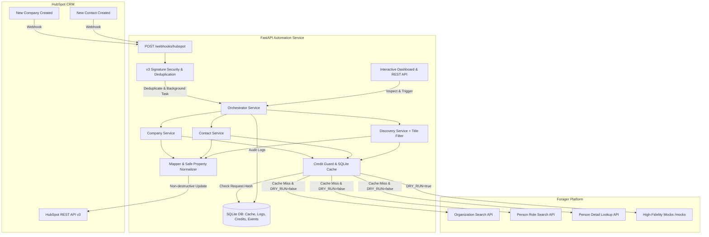
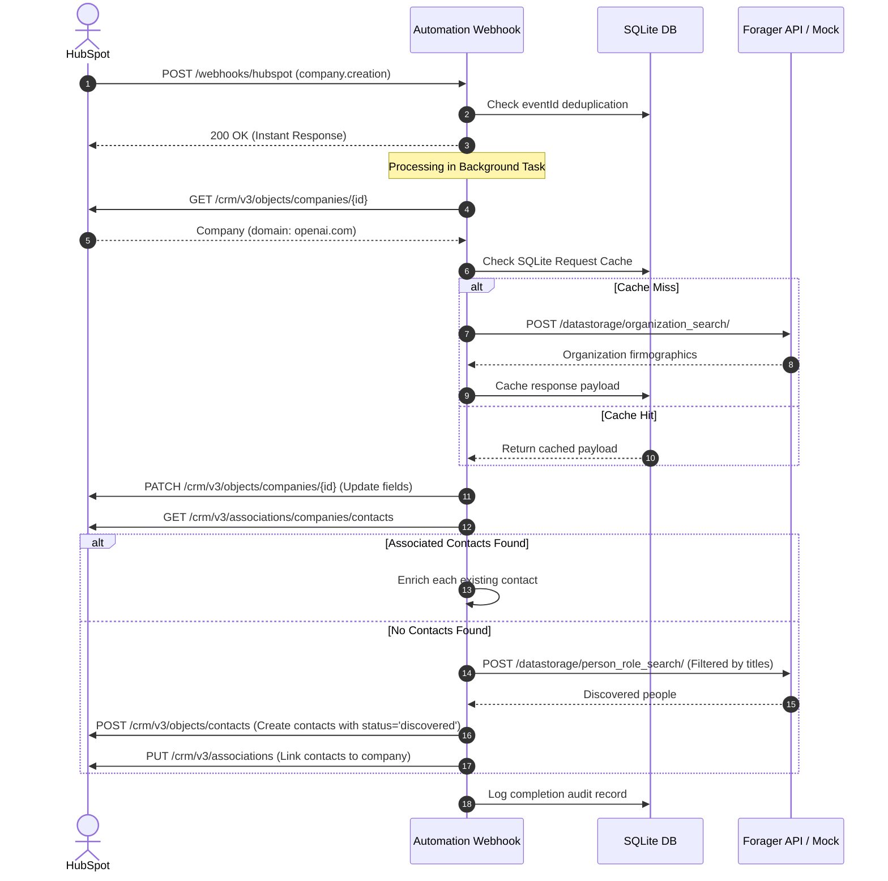

# System Architecture & Flow Documentation

## 1. High-Level Architecture Overview

The `forager-hubspot-enrichment` service is a production-grade FastAPI application engineered to bridge HubSpot CRM and Forager's B2B data enrichment APIs with strict credit preservation, idempotency, and job-title filtering.

---

## 2. Core Service Workflows

### A. Company Webhook Flow (`company.creation`)
1. **Receipt & Fast Acknowledgment:** The webhook hits `POST /webhooks/hubspot`. Signature is checked (if enabled). Event is deduplicated by `eventId` in `webhook_events`. Returns `200 OK` immediately.
2. **Background Execution:** FastAPI background task dispatches to `Orchestrator.handle_company_webhook(object_id)`.
3. **HubSpot Fetch:** Reads the company record from HubSpot to extract `domain`.
4. **Idempotency Check:** If `forager_status == 'enriched'`, skip to prevent unnecessary credit usage.
5. **Forager Company Enrichment:** Queries Forager for firmographics. Maps fields non-destructively and updates the company in HubSpot.
6. **Associated Contacts Check:** Fetches existing contacts associated with the company in HubSpot.
   - **Branch 1 (Contacts exist):** Enriches each contact (skipping those already marked `enriched`).
   - **Branch 2 (No contacts exist):** Calls `DiscoveryService` to find employees at `domain` matching target job titles (e.g. CEO, CTO, VP, Head of, Director). Limits to `DEFAULT_CONTACT_LIMIT` (5). Creates them in HubSpot, sets `forager_status='discovered'`, and associates them with the company.
7. **Audit & Logging:** Writes full audit step to `enrichment_log`.

---

### B. Contact Webhook Flow (`contact.creation`)
1. **Receive & Deduplicate:** Verifies signature, checks `eventId`, returns HTTP 200.
2. **Loop Prevention Guard:** Inspects if contact was created by our own discovery step (`forager_status == 'discovered'`). If so, mark processed and exit immediately to avoid an infinite loop.
3. **HubSpot Fetch:** Reads contact details (`email`, `firstname`, `lastname`, `company`, `company_domain`).
4. **Enrichment:**
   - Look up by email or personal LinkedIn URL.
   - Retrieve full contact details (headline, location, skills, employer domain).
5. **Update HubSpot:** Non-destructive update writing only non-empty fields and stamping `forager_status='enriched'`.

---

### C. Contact Discovery & Dual-Layer Job Title Filtering
To ensure that only relevant executives and leaders are surfaced, we employ a **dual-layer filtering approach**:
1. **Layer 1 (Native Forager Filter):** The query sent to Forager's `person_role_search` endpoint specifies `role_title` terms and `role_is_current=true`.
2. **Layer 2 (Local Deterministic Keyword Engine):** Because remote search indexes can occasionally return loose partial matches, all returned profiles are strictly passed through a local Python regex matcher that checks whether the candidate's normalized job title contains at least one of the approved keywords (e.g., `CEO`, `CTO`, `VP`, `Vice President`, `Head of`, `Director`). Profiles that fail both are rejected before being added to HubSpot or consuming credit.

---

## 3. Database Schema

- **`enrichment_cache`**: SHA-256 hash of endpoint and body -> response JSON. Permanent cache prevents duplicate credit spend.
- **`enrichment_log`**: Records every enrichment action (entity type, ID, identifier, status, message, JSON details, timestamp).
- **`credit_usage`**: Ledger recording operation, target, credits consumed, mock status, and execution run ID.
- **`webhook_events`**: Tracks incoming event IDs, payload, status, and errors for guaranteed idempotency.

---

## 4. Security & Sensitive Variables
- **API Keys & Secrets:** Kept exclusively in `.env` and injected via `pydantic-settings`.
- **Log Redaction:** `SecretMaskingFilter` automatically intercepts log messages and masks any string matching API key patterns (`pat-*`, `Bearer *`, `X-API-KEY*`, secrets).
- **HubSpot v3 Request Validation:** Computes HMAC SHA-256 with timestamp verification to reject spoofed webhooks and replay attacks.
